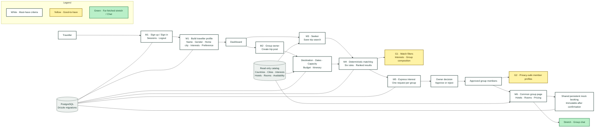

<p align="center">
  
</p>

<h1 align="center">Nomad</h1>

<p align="center">
  <strong>Find your people. Explore the world.</strong><br />
  A thoughtful, rule-based group travel matcher for solo travellers.
</p>

<p align="center"><em>Good trips start with a hello.</em></p>

---

## The idea

Travelling alone is liberating; finding the right people to travel with is harder. Nomad turns that uncertainty into a clear, human journey. A traveller creates a profile, describes the kind of trip they want, discovers compatible groups, and joins the one that fits their plans, preferences, budget, and rhythm.

For group owners, Nomad provides a structured way to create a trip, review requests, and build a small group around shared intent. For seekers, it provides a transparent way to understand why a group is a good fit. The product is deliberately grounded in real database records and deterministic rules—not invented people, opaque recommendations, or artificial activity.

## What is complete

**All six core milestones, the planned good-to-have features, and the final stretch Chat capability have been covered end to end.** The green Chat node represents the far-fetched extension that is now included in the shared group experience.

## Architecture at a glance

The diagram is also the product story: a traveller enters through authentication, builds a profile, searches or creates a trip, moves through matching and consent, and reaches a shared group experience.



### Reading the colours

| Colour | Meaning |
|---|---|
| White | Must-have functionality required for the core user journey and judged milestones |
| Yellow | Good-to-have functionality that deepens discovery, filtering, and privacy |
| Green | The far-fetched stretch: the shared group-chat collaboration layer |

## The complete traveller flow

1. **Create an account** — Sign up, sign in, and receive a database-backed session.
2. **Build a profile** — Add the traveller details and interests that shape compatibility.
3. **Choose a direction** — Search for a group or become an owner and create one.
4. **Describe the trip** — Select a valid country and city, dates from the supported window, capacity, budget, and itinerary.
5. **Find a fit** — Matching checks the full rule set and ranks qualifying groups consistently.
6. **Ask to join** — A seeker expresses interest; the owner receives the pending request.
7. **Make a decision** — The owner approves or rejects. The state is saved and the rules are checked again before the decision.
8. **Plan together** — Approved members see the common group page, privacy-safe member information, and accommodation options.
9. **Confirm together** — The group can confirm one shared mock booking; the confirmed state is visible to all approved members.

## Milestone coverage

### M1 · Authentication and traveller profile

- Sign up, sign in, duplicate-account prevention, and immediate logout.
- Database-backed, HTTP-only cookie sessions with expiry and revocation.
- Profile setup for name, gender, home city/origin, interests, and gender preference.
- One-time username editing and dashboard profile visibility.
- Privacy-aware rendering: only permitted information is exposed to other travellers.

### M2 · Group owner trip creation

The owner can create a group post with a group name, destination country and city, check-in and check-out dates, desired group size, approximate budget, and proposed itinerary. The owner is automatically represented in the group membership state.

Countries and cities come from the controlled catalog: selecting **Japan** exposes **Osaka, Tokyo, and Kyoto**; selecting **United Arab Emirates** exposes **Abu Dhabi and Dubai**.

### M3 · Seeker search

The seeker can save a search using origin/home city, destination, dates, interests, budget, and gender preference. Search inputs are validated against the same catalog used by group creation.

### M4 · Matching and ranking

Nomad uses six explicit rules: destination compatibility, at least two shared nights, budget tolerance, at least two shared interests, two-way gender-preference compatibility, and remaining capacity. Existing memberships, booked groups, and invalid candidates are excluded. Results are ranked deterministically by shared interests, shared nights, budget gap, check-in date, and stable group order.

### M5 · Accept or decline

Seekers can express interest in a group. Owners can approve or reject pending requests. Request state is persistent, duplicate requests are prevented, capacity is protected, the rules are rechecked before request creation and approval, and a rejection blocks another request to the same group.

### M6 · Common group experience

Approved members can compare hotels and rooms using server-side availability, pricing, rating, refundability, and sorting. The application supports one shared mock booking per group. Once confirmed, the booking is persistent and immutable for the group; it is not a real hotel reservation and does not process payment.

## Good-to-have coverage

### G1 · Match filters

The ranked match list can be narrowed using shared-interest filters and group-composition filters such as Any, All female, All male, and Mixed. The filters are URL-backed, preserve request state, and do not replace the underlying matching rules.

### G2 · Traveller and member profiles

Approved or mutually connected travellers can open privacy-safe profile pages containing permitted details such as name, age when available, home city or airport, interests, shared interests, approved groups, role, counts, and booking state where relevant. Email, username, user ID, gender, and gender preference are intentionally excluded.

Unknown, pending-only, rejected-only, or unrelated profiles resolve to the same unavailable state; the interface does not leak private membership information.

## Key decisions, questions, and future scope

The following points are **our own product decisions and pivots**, not additional requirements in the judging criteria. They are recorded here so the behaviour, assumptions, and boundaries remain visible.

### What happens if a group wants to change its hotel after booking?

The current M6 booking is intentionally immutable. A future version could provide either:

- **Cancel and rebook:** cancel the existing selection, reopen hotel comparison, and confirm a replacement; or
- **Edit booking:** allow the owner or the group to replace the selected hotel through a controlled amendment flow.

Neither cancellation nor editing is part of the current judged criteria. The present implementation protects the confirmed state rather than pretending that a real hotel reservation can be modified.

### What if a seeker requests multiple groups and is accepted later by more than one?

The proposed policy is **first approval wins, based on time**. Once one group accepts the traveller, a later owner approval must fail with a clear notification that the traveller has already joined another group. The decision is not based on cost, budget, or a second round of preference ranking; all six matching criteria must still be valid, but approval order resolves the competing acceptance.

This cross-group exclusivity rule is a future-scope policy unless explicitly enabled in the current milestone implementation. It is documented here as an important consistency question rather than hidden behaviour.

### What if one person wants to travel alone?

For the case of one traveller with no booking requests, a future version may offer a simple **Book on Booking.com** redirect. This would be a URL-only button: no Booking.com API call, no scraped availability, and no booking data stored by Nomad. It is future scope and is not part of the current criteria.

### The far-fetched stretch: collaborative group chat

The final stretch adds a Chat feature to the Common Group Page for every approved member. Whether the group has two travellers or three, the same shared conversation becomes the place where members collaborate on the practical details of their trip: choosing a hotel, shaping the itinerary, coordinating plans, sharing meeting points, and discussing pickup or arrival arrangements.

This is more than a messaging box; it is Nomad’s collaboration layer. Instead of taking decisions offline across disconnected channels, members can discuss the trip together in one shared space and arrive at a plan everyone understands. A two-member trip uses the same experience as a three-member trip—the conversation simply includes every approved member of that group.

Chat is the final stretch capability in the current build. Its boundary is clear: only approved members of the same group can participate, and the conversation belongs to that group’s shared travel context.

## Constraints and edge cases

- The supplied data files are read-only and must not be changed.
- The catalog is the source of truth for countries, cities, interests, hotels, rooms, and availability.
- All traveller and group names shown by the product come from real database records or user-created records; no random names or fabricated activity are displayed.
- If there are no records, Nomad shows an honest empty state instead of a placeholder person or group.
- All dates and supported destinations are constrained by the provided problem data.
- A group cannot exceed its configured capacity.
- A seeker cannot create duplicate requests for the same group.
- A rejected seeker cannot request the same group again.
- Only an owner can decide on requests for their group.
- Only approved members can access the common group experience.
- A confirmed mock booking cannot be silently overwritten.
- Hotel pricing and availability are calculated server-side rather than trusted from the browser.
- A failed request or approval must not leave a half-written membership state.
- Real hotel reservations, payments, cancellation processing, external booking APIs, and the hotel-edit flow remain outside the current implementation unless explicitly listed above as future scope.

## Data pack

| File | Record | Used for |
|---|---|---|
| `data/problem-3/travellers.json` | Traveller profile | Existing owners and members |
| `data/problem-3/groups.json` | Open group post | Starting group results |
| `data/problem-3/interests.json` | Interest tag | Profile and search forms |
| `data/catalog/destinations.json` | Country and city catalog | Group creation and search |
| `data/catalog/hotels.json` | Hotel | M6 accommodation comparison |
| `data/catalog/rooms.json` | Room type | Capacity and nightly price |
| `data/catalog/availability.json` | Room-night availability | Server-side availability checks |
| `images/hotels/` | Hotel photo | Optional hotel imagery |

The data is synthetic except for the freely licensed hotel photographs. See `images/ATTRIBUTIONS.md` for credits. All prices are in INR and all times are local.

## Technical architecture

Nomad is intentionally simple to run and easy to reason about:

- **Frontend:** React, TypeScript, and Vite
- **Backend:** Express and TypeScript
- **Database:** PostgreSQL with Drizzle ORM and migrations
- **Shared contract:** Zod schemas and shared types in `packages/shared`
- **Authentication:** database-backed HTTP-only cookie sessions
- **Source of truth:** backend validation, authorization, matching, pricing, and state transitions

The frontend never reads the data files directly. It communicates with the backend through the shared API contract in `docs/api-contract.md`.

## Database overview

### Read-only catalog tables

`destination_countries`, `destination_cities`, `departure_cities`, `interests`, `hotels`, `rooms`, and `availability`.

### Application tables

`users`, `sessions`, `travellers`, `groups`, `searches`, `group_memberships`, `saved_options`, and `bookings`.

Foreign keys, unique constraints, check constraints, transactions, and row-level locking protect the relationships between accounts, profiles, groups, requests, and bookings.

## Run Nomad locally

Requires Node 20.12+ and Docker for PostgreSQL.

```bash
cp .env.example .env
npm install
docker compose up -d
npm run db:migrate
npm run db:seed
npm run dev
```

Open `http://localhost:5173` and check the API at `http://localhost:5173/api/health`.

Useful commands:

```bash
npm run typecheck
npm run lint
npm run format
npm run db:generate
```

After changing `apps/api/src/db/schema.ts`, run `npm run db:generate` and then `npm run db:migrate`.

## Repository map

| Folder | Purpose |
|---|---|
| `apps/web` | React + TypeScript + Vite frontend |
| `apps/api` | Express + TypeScript API and Drizzle/Postgres integration |
| `packages/shared` | Shared Zod schemas and types |
| `docs/api-contract.md` | Request and response formats |
| `docs/decisions.md` | Product decisions, scope changes, and rationale |
| `assets/nomad.png` | Nomad brand mark used in this README |

## The promise

Nomad is built around a small idea with a large human payoff: the best trips are not only about where we go, but who is there when we arrive. By making compatibility explicit, consent persistent, and planning shared, Nomad helps a hello become a crew—and a trip become a story worth remembering.
